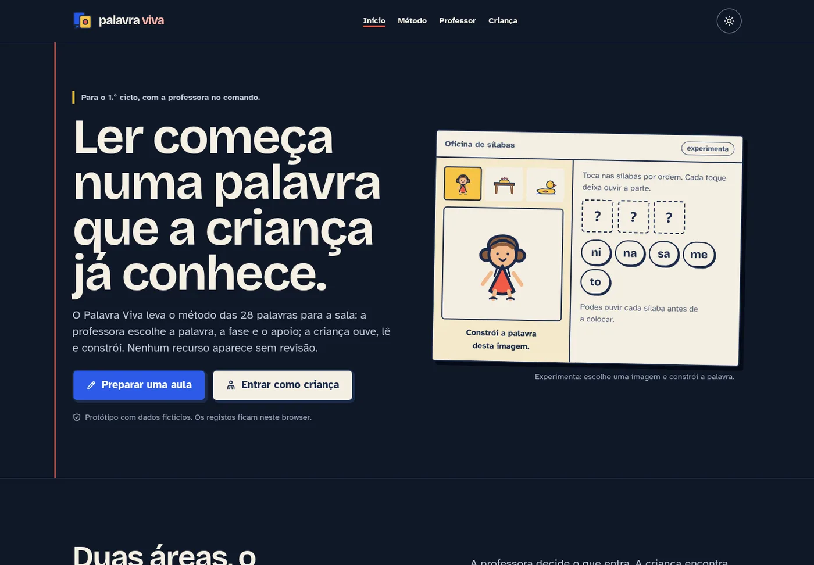
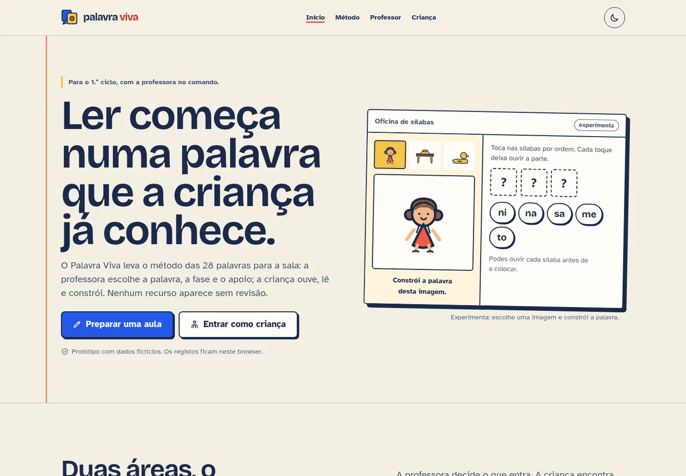
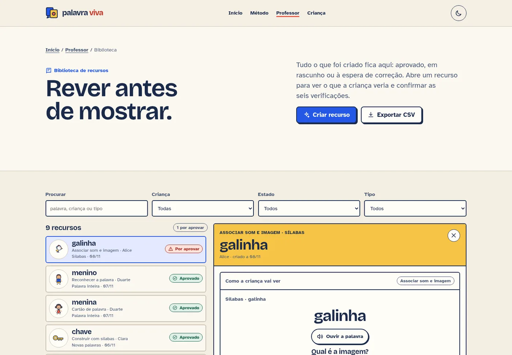
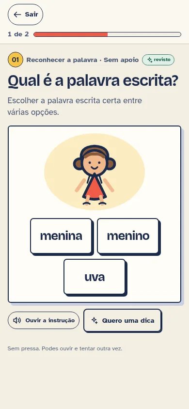

# Palavra Viva

[](https://deno.com/)
[](https://svelte.dev/)
[](https://svelte.dev/docs/kit)
[](https://www.typescriptlang.org/)
[](https://developer.chrome.com/docs/lighthouse/overview)
[](https://github.com/kill74/palavra-viva/actions/workflows/ci.yml)
[](https://kill74.github.io/palavra-viva/)

```text
╭─────────────────────────────────────────────────────────────────────────────────────────────╮
│                                                                                             │
│ ██████╗  █████╗ ██╗      █████╗ ██╗   ██╗██████╗  █████╗    ██╗   ██╗██╗  ██╗   ██╗ █████╗  │
│ ██╔══██╗██╔══██╗██║     ██╔══██╗██║   ██║██╔══██╗██╔══██╗   ██║   ██║██║  ██║   ██║██╔══██╗ │
│ ██████╔╝███████║██║     ███████║██║   ██║██████╔╝███████║   ██║   ██║██║  ██║   ██║███████║ │
│ ██╔═══╝ ██╔══██║██║     ██╔══██║╚██╗ ██╔╝██╔══██╗██╔══██║   ╚██╗ ██╔╝██║  ╚██╗ ██╔╝██╔══██║ │
│ ██║     ██║  ██║███████╗██║  ██║ ╚████╔╝ ██║  ██║██║  ██║    ╚████╔╝ ██║   ╚████╔╝ ██║  ██║ │
│ ╚═╝     ╚═╝  ╚═╝╚══════╝╚═╝  ╚═╝  ╚═══╝  ╚═╝  ╚═╝╚═╝  ╚═╝     ╚═══╝  ╚═╝    ╚═══╝  ╚═╝  ╚═╝ │
│                                                                                             │
│                   método das 28 palavras · svelte 5 · deno · offline-first                  │
╰─────────────────────────────────────────────────────────────────────────────────────────────╯
```

Protótipo funcional para o Trabalho Prático 1 de **Design de Sistemas Interativos**:
um sistema interativo com IA generativa para aprender a ler pelo **Método das 28 Palavras**.

A aplicação separa dois percursos que se encontram numa revisão obrigatória:

1. **A professora prepara.** Escolhe a criança, a palavra, a fase, o tipo de atividade e o
   número de opções. Recebe uma proposta com prompt, campos editáveis e seis verificações.
2. **A criança aprende.** Só vê recursos aprovados. Ouve, lê, escolhe, constrói sílabas e
   resolve frases curtas, com feedback imediato e nova tentativa.

> Todos os nomes, registos e sessões são fictícios. Os dados ficam apenas no browser.

**Demonstração pública:** https://kill74.github.io/palavra-viva/

<p align="center">
  
</p>

---

## Executar

Pré-requisitos: **Deno 2.9+** e um browser atual. Não é necessário instalar Node, npm, yarn
ou pnpm. As dependências npm são resolvidas pelo Deno através de `npm:` em `deno.json`.

```bash
# desenvolvimento com HMR
deno task dev

# gerar tipos e configuração do SvelteKit (necessário antes do primeiro check)
deno task sync

# verificação de tipos e acessibilidade do compilador Svelte
deno task check

# build estático para ./build
deno task build

# pré-visualizar o build (porta indicada, para testes Lighthouse)
deno task preview --port 4173

# build para GitHub Pages, servido em /palavra-viva/
BASE_PATH=/palavra-viva deno task build
```

O site é totalmente pré-renderizado com `@sveltejs/adapter-static`. O resultado em `build/`
pode ser servido por qualquer alojamento estático. O fallback `404.html` garante a página de
erro em servidores estáticos.

### Publicação

O workflow `.github/workflows/pages.yml` constrói o site com `BASE_PATH=/palavra-viva` e
publica-o no GitHub Pages em cada push para `main`. A demonstração fica em
**https://kill74.github.io/palavra-viva/**. Todas as rotas são geradas como pastas com
`index.html`, para funcionarem sem extensão no alojamento estático.

### Stack

- **Deno 2.9** como runtime e gestor de tarefas (`deno task`).
- **Svelte 5** com runes (`$state`, `$derived`, `$effect`, `$props`).
- **SvelteKit 3** com `adapter-static` e pré-renderização de todas as rotas.
- **TypeScript 6** em modo `strict`, verificado por `svelte-check`.
- **Vite 8** para desenvolvimento e build.
- Sem backend e sem API em tempo de execução. O estado persistente vive em `localStorage`.
- Imports internos com subpath imports (`#lib/...`), configurados em `package.json` e
  `tsconfig.json`, sem aliases deprecados do SvelteKit.

### Limpar os dados da demonstração

A turma, os recursos e as sessões são guardados em `localStorage`. Para voltar ao estado
inicial, abrir a consola do browser e executar:

```js
localStorage.removeItem('palavra-viva:dados:v1');
localStorage.removeItem('palavra-viva:tema');
location.reload();
```

---

## Percurso de demonstração (3 minutos)

1. **`/`** — conhecer a proposta, a sequência das 28 palavras e a oficina de sílabas.
2. **`/professor`** — ver a turma fictícia, os percursos em curso e a fila de revisão.
3. **`/professor/criar`** — pedir um recurso para a Alice, escolher palavra, fase e tipo;
   observar o prompt, a proposta, as seis verificações e aprovar.
4. **`/professor/biblioteca?recurso=rec-alice-galinha`** — abrir um rascunho preparado,
   corrigir campos, confirmar a validação e aprovar.
5. **`/crianca`** — escolher a Alice e entrar numa atividade aprovada.
6. **`/crianca/sessao?crianca=alice`** — ouvir, responder, errar, tentar outra vez, usar
   ajuda e concluir a sessão.
7. **`/professor/sessoes`** — consultar tentativas, ajudas, respostas autónomas/apoiadas,
   registar uma ficha de escrita em papel e exportar CSV.

Atalhos úteis:

- `/professor/biblioteca?recurso=rec-alice-galinha` — rascunho de associação som–imagem.
- `/professor/sessoes?crianca=alice` — registos filtrados por criança.
- `/crianca/sessao?crianca=alice&recurso=rec-alice-menina` — abrir uma atividade concreta.

---

## Capturas

**Tema claro e biblioteca.** A mesma página no tema claro e a área onde a professora revê,
corrige e aprova cada recurso antes de o mostrar à criança.

| Página inicial (tema claro) | Biblioteca de recursos |
| :---: | :---: |
|  |  |

**Sessão da criança.** Instruções curtas, botões grandes, áudio repetível e progresso visível
num ecrã mobile.

<p align="center">
  
</p>

---

## O que está implementado

### Área da professora

- Visão da turma, fase de cada criança, palavras trabalhadas e autonomia das respostas.
- Fila de propostas por aprovar e atalhos para criação, biblioteca e registos.
- **Estúdio de criação** com criança, palavra, fase, tipo, número de opções e apoios.
- Prompt completo e visível, proposta editável, feedback e seis verificações.
- Marcação automática de rascunho; aprovação, devolução a rascunho e eliminação.
- Biblioteca com procura, filtros por estado e tipo, pré-visualização e exportação CSV.
- Registo de sessões com tentativas, ajudas, áudio, dica, resposta autónoma/apoiada e tempo.
- Registo da conclusão de uma ficha de cópia em papel (`RegistoEscrita`), sem substituir a
  escrita manual por uma atividade digital.

### Área da criança

- Escolha de criança e lista de atividades **apenas aprovadas**.
- Instruções curtas, botões grandes, foco visível e áudio repetível.
- **Cartão** de palavra com imagem e áudio.
- **Reconhecimento** da palavra escrita entre 2–4 opções, com posição variável.
- **Associação** som–imagem, com o áudio sem revelar a solução.
- **Sílabas**: ouvir cada parte, reconstruir a palavra e ouvir o resultado.
- **Frase curta**: ler e escolher a imagem correspondente.
- Feedback imediato, nova tentativa, ajuda registada e conclusão da sessão.
- Distinção explícita entre resposta **autónoma** (certa à primeira) e **apoiada**.

### Método e conteúdo

- Sequência adotada: **menina, menino, uva, sapato, bota, mamã, leque, casa, janela,
  telhado, escada, chave, galinha, gema, rato, cenoura, girafa, palhaço, zebra, peixe,
  bandeira, funil, árvore, quadro, passarinho, cigarra, fogueira, flor.**
- A variante «dedo/ovo» é reconhecida na página de método, mas não é misturada com a
  sequência principal.
- Seis palavras derivadas para recombinação: **mesa, pato, nave, bola, gato, mala**.
- 28 fichas nucleares + 6 derivadas, com ilustração, sílabas, frase de referência e áudio.
- Áudio sintetizado em **português europeu** (voz Piper `pt_PT-tugão`), pré-gerado.
- Ilustrações SVG originais, sem dependências de terceiros em tempo de execução.

### IA generativa e validação

O protótipo usa **geração prévia**, como o enunciado permite: não há chamadas a APIs em
tempo de execução. O pedido da professora produz um prompt completo (guardado no recurso)
e uma proposta composta a partir do léxico validado. A decisão final é humana.

As seis verificações automáticas estão em `src/lib/utils/validacao.ts`:

1. **Ortografia** — a forma existe no léxico do método.
2. **Divisão silábica** — as sílabas juntas reconstroem exatamente a palavra.
3. **Palavra–imagem** — a ilustração pertence ao mesmo registo da palavra.
4. **Pronúncia** — existe áudio pt-PT validado para a forma.
5. **Opções** — quantidade, unicidade, inclusão da resposta e distratores adequados.
6. **Frase** — tamanho, pontuação, palavra-alvo, ligações conhecidas e coerência com o áudio.

A aprovação fica bloqueada enquanto qualquer verificação falhar. O recurso permanece em
rascunho e não aparece à criança.

---

## Decisões de design

### Identidade «Palavra Viva»

- **Metáfora:** uma oficina de papel, com fichas de trabalho, carimbos e sílabas móveis.
- **Paleta:** papel (`#f4efe3`), tinta (`#1b2a4a`), cobalto (`#2457e6`), coral (`#f05a47`),
  sol (`#f6c445`) e verde (`#3e7c6a`). O tema escuro troca o papel pelo azul-noite, mas as
  fichas continuam claras para preservar contraste e a sensação de papel.
- **Tipografia:** Bricolage Grotesque nos títulos, Atkinson Hyperlegible no texto. Ambas são
  auto-alojadas em WOFF2, com licenças OFL em `static/fonts/`.
- **Elemento memorável:** a **Oficina de sílabas** — peças de cartão que se arrastam, se
  ouvem e se voltam a juntar. É o momento de movimento orquestrado do percurso.
- **Linguagem:** português europeu, frases curtas, sem infantilizar a professora nem
  transformar a criança num «utilizador de teste».

### Interação

- Estrutura em duas passagens: **a IA propõe, a professora revê, a criança recebe**.
- O áudio é sempre repetível e tem rótulo textual; nunca é a única forma de aceder à
  informação.
- Na tarefa de reconhecimento, o áudio não revela a solução. Na associação, o áudio é a
  pista principal.
- As opções são baralhadas de forma determinística por pedido, para variar a posição.
- Feedback claro, sem elogios vazios; o erro dá uma pista concreta e permite nova tentativa.
- A autonomia é registada por resposta, não convertida numa nota.

### Acessibilidade

- HTML semântico, um `h1` por página, marcos de navegação e ligação «Saltar para o conteúdo».
- Foco visível com contraste reforçado, navegação por teclado e fecho do menu com `Escape`.
- `prefers-reduced-motion` desativa transições e View Transitions.
- Contraste WCAG 2.1 AA verificado em todos os percursos, nos temas claro e escuro.
- Estados de erro, vazio, carregamento e sucesso anunciados com `role="status"`/`role="alert"`.
- Formulários com etiquetas explícitas; botões com nomes acessíveis; imagens com `alt`
  descritivo ou `alt=""` quando decorativas.

### Desempenho

- Página estática, sem servidor nem pedidos de API em tempo de execução.
- Fontes auto-alojadas e pré-carregadas; ilustrações SVG; áudio só é pedido quando usado.
- Sem bibliotecas de UI, sem ícones remotos e sem fontes do Google.
- Animações limitadas a `transform` e `opacity`.
- Layout estável: dimensões explícitas em imagens e ausência de `CLS` nas auditorias.

---

## Validação

### Integração contínua

O workflow `.github/workflows/ci.yml` corre em cada push para `main`, em pull requests e
manualmente. Instala as dependências com `deno install --frozen`, gera os tipos com
`deno task sync`, executa `deno task check`, constrói o site com `deno task build` e guarda
`build/` como artefacto durante sete dias.

### Tipos e build

```text
deno task check  → 0 erros, 0 avisos
deno task build  → site estático escrito em build/
```

### Testes funcionais

Executados com Playwright contra o build de pré-visualização:

- alternância e persistência do tema claro/escuro;
- menu móvel, foco e fecho com `Escape`;
- escolha de criança e entrada numa sessão;
- resposta certa, resposta errada, nova tentativa, ajuda e conclusão;
- gravação da sessão e atualização dos registos;
- aprovação e devolução de recursos na biblioteca;
- criação, validação e aprovação de um recurso no estúdio;
- exportação CSV;
- página 404;
- ausência de erros na consola.

### Acessibilidade

Auditoria axe-core (WCAG 2 A/AA + 2.1 A/AA) em 9 rotas, nos temas claro e escuro:

```text
claro  home · método · professor · criar · biblioteca · sessões · criança · sessão · erro  → ok
escuro home · método · professor · criar · biblioteca · sessões · criança · sessão · erro  → ok
```

0 violações de contraste, nomes acessíveis, estrutura ou teclado.

### Lighthouse

Lighthouse 13.0.1, Chromium 155, build de produção em `http://127.0.0.1:4173`.
Mobile usa a simulação padrão (Slow 4G, CPU 4×); desktop usa `--preset=desktop`.

| Rota | Performance | Acessibilidade | Boas práticas | SEO | LCP | CLS |
| --- | ---: | ---: | ---: | ---: | ---: | ---: |
| `/` mobile | 97 | 100 | 100 | 100 | 2,3 s | 0 |
| `/` desktop | 100 | 100 | 100 | 100 | 0,5 s | 0 |
| `/professor` mobile | 98 | 100 | 100 | 100 | 2,1 s | 0 |
| `/professor/criar` mobile | 97 | 100 | 100 | 100 | 2,3 s | 0 |
| `/professor/biblioteca` mobile | 96 | 100 | 100 | 100 | 2,4 s | 0 |
| `/professor/sessoes` mobile | 98 | 100 | 100 | 100 | 2,3 s | 0 |
| `/crianca` mobile | 98 | 100 | 100 | 100 | 2,3 s | 0 |
| `/crianca/sessao?crianca=alice` mobile | 97 | 100 | 100 | 100 | 2,3 s | 0 |
| `/metodo` mobile | 98 | 100 | 100 | 100 | 2,3 s | 0 |

Todas as categorias estão **≥ 95**. Em desktop, o LCP é 0,5 s e o TBT é 0 ms. Em mobile, o
LCP simulado fica entre 2,1 e 2,4 s por causa do modelo Slow 4G da ferramenta; o valor real
observado no browser, sem essa simulação, é próximo de 1 s. O objetivo principal do
trabalho é a qualidade da interação, não um orçamento de desempenho definido no enunciado.

Para repetir:

```bash
deno task build
deno task preview --port 4173
cd /tmp/opencode
CHROME_PATH=/usr/bin/chromium npx --yes lighthouse@13.0.1 \
  http://127.0.0.1:4173/ \
  --quiet \
  --chrome-flags="--headless --no-sandbox --disable-gpu" \
  --only-categories=performance,accessibility,best-practices,seo \
  --output=json --output-path=./lighthouse.json
```

O `npx` é usado apenas para executar a ferramenta de auditoria; **não** é usado para gerir
o projeto.

---

## Requisito → ficheiro

| Requisito do enunciado | Onde está |
| --- | --- |
| IA generativa para criar recursos | `src/lib/utils/gerador.ts`, `src/lib/data/prompts.ts`, `src/routes/professor/criar/+page.svelte` |
| Input: palavra, fase, tipo e número de opções | `src/routes/professor/criar/+page.svelte`, `src/lib/components/CamposRecurso.svelte`, `src/lib/data/tipos.ts` |
| Revisão, correção e aprovação antes da criança | `src/routes/professor/biblioteca/+page.svelte`, `src/lib/utils/validacao.ts`, `src/lib/components/ListaValidacao.svelte` |
| Pelo menos dois tipos de recurso | `src/routes/crianca/sessao/+page.svelte` (cartão, reconhecimento, associação, sílabas, frase), `src/lib/data/tipos.ts` |
| Área da professora e área da criança | `src/routes/professor/`, `src/routes/crianca/`, `src/lib/components/Cabecalho.svelte` |
| Instruções curtas e áudio repetível | `src/routes/crianca/sessao/+page.svelte`, `src/lib/components/BotaoAudio.svelte`, `src/lib/utils/audio.ts` |
| Botões legíveis e interação simples | `src/app.css`, `src/lib/components/`, `src/routes/crianca/` |
| Validar ortografia e divisão silábica | `src/lib/utils/validacao.ts` (regras 1 e 2), `src/lib/data/palavras.ts` |
| Validar palavra–imagem | `src/lib/utils/validacao.ts` (regra 3), `src/lib/data/palavras.ts`, `src/lib/components/Ilustracao.svelte` |
| Validar pronúncia em pt-PT | `src/lib/utils/validacao.ts` (regra 4), `static/audio/`, `src/lib/data/prompts.ts` |
| Reconhecimento com número variável de opções | `src/lib/utils/gerador.ts` (`numeroOpcoesSugerido`, `distratoresDePalavra`), `src/routes/crianca/sessao/+page.svelte` |
| Imagens e áudio em português europeu | `static/palavras/`, `static/audio/`, `src/lib/data/palavras.ts` |
| Associação palavra–imagem–áudio | atividade `associacao` em `src/routes/crianca/sessao/+page.svelte`, `src/lib/components/MuralPalavras.svelte` |
| Segmentação e reconstrução de sílabas | `src/lib/components/MesaSilabas.svelte`, atividade `silabas` em `src/routes/crianca/sessao/+page.svelte` |
| Formação de novas palavras | `src/lib/data/palavras.ts` (derivadas), `src/lib/components/MesaSilabas.svelte`, `/metodo#fases` |
| Leitura de frases curtas | atividade `frase` em `src/routes/crianca/sessao/+page.svelte`, `src/lib/data/palavras.ts` |
| Correção automática, feedback e nova tentativa | `src/lib/utils/gerador.ts` (`feedbackCerto`/`feedbackErrado`), `src/routes/crianca/sessao/+page.svelte` |
| Registar resultados, tentativas e ajudas | `src/lib/stores/dados.svelte.ts`, `src/routes/professor/sessoes/+page.svelte` |
| Distinguir respostas autónomas de apoiadas | `src/lib/data/tipos.ts` (`Resposta.acertouPrimeira`), `src/lib/stores/dados.svelte.ts` (`estatisticas`), `/professor` e `/professor/sessoes` |
| Escrita manual complementar | `src/lib/data/tipos.ts` (`RegistoEscrita`), `src/routes/professor/sessoes/+page.svelte` |
| Sequência das 28 palavras | `src/lib/data/palavras.ts`, `/metodo#sequencia` |
| Dados fictícios | `src/lib/data/demo.ts`, avisos em `/`, `/professor` e `/crianca` |
| Tema claro/escuro persistente | `src/lib/stores/tema.svelte.ts`, `src/app.html`, `src/app.css` |
| View Transitions e movimento reduzido | `src/routes/+layout.svelte`, `src/app.css` |
| SEO, Open Graph, favicon e manifest | `src/app.html`, `src/routes/+layout.svelte`, `static/favicon.svg`, `static/og.png`, `static/manifest.webmanifest` |
| Página 404 e estados de erro | `src/routes/+error.svelte`, `src/error.html`, `build/404.html` |
| README e decisões | este ficheiro |

---

## Estrutura

```text
.github/
  workflows/ci.yml           verificação e build em GitHub Actions
  workflows/pages.yml        publicação no GitHub Pages
src/
  app.css                    tokens, tipografia, componentes globais, temas
  app.html                   head base, tema sem flash, fontes, metadados
  error.html                 fallback estático de erro
  lib/
    components/              UI reutilizável (fichas, áudio, sílabas, validação...)
    data/
      palavras.ts            léxico, sílabas, frases, derivadas
      demo.ts                turma, recursos, sessões e escritas fictícias
      prompts.ts             prompts, modelo declarado e exemplos de revisão
      tipos.ts               tipos e nomes de fases/tipos
      metodo.ts              texto metodológico, limites, decisões e referências
    stores/
      dados.svelte.ts        estado + localStorage (recursos, sessões, escritas)
      tema.svelte.ts         tema claro/escuro persistente
    utils/
      gerador.ts             composição determinística de propostas
      validacao.ts           seis regras de validação
      audio.ts               reprodução e estados de áudio
      consulta.ts            leitura de query params só no cliente
      formato.ts             datas, percentagens e plurais
  routes/
    +page.svelte             visão geral e oficina de sílabas
    metodo/                  método, sequência, IA, testes e referências
    professor/               painel, criar, biblioteca, sessões
    crianca/                 escolha e sessão de atividades
static/
  audio/                     160 MP3 pt-PT pré-gerados
  palavras/                  34 ilustrações SVG originais
  fonts/                     Bricolage + Atkinson (WOFF2, OFL)
```

---

## Limitações e melhorias possíveis

- **Sem API em tempo de execução.** A geração é prévia e o catálogo é finito. Uma versão
  com API exigiria validação humana, limites de custo, moderação e registo de proveniência.
- **Sem reconhecimento de leitura oral.** A correção é por regras em respostas fechadas.
  A oralidade continua a ser observada pela professora.
- **Dados locais.** Não há contas, sincronização nem backend; limpar o `localStorage`
  repõe a demonstração. Para uso real seria necessário consentimento, retenção e proteção
  de dados de menores.
- **Voz sintetizada.** Consistente em pt-PT, mas não substitui entoação, afeto e correção
  humana.
- **LCP mobile simulado.** A pontuação de desempenho cumpre ≥95; o LCP mobile do Lighthouse
  é influenciado pela simulação Slow 4G. Em desktop é 0,5 s.
- **Melhorias prioritárias:** testes automatizados em CI, métricas de campo, mais palavras
  e distratores, modo offline/PWA, importação/exportação de dados da turma e um fluxo de
  revisão com histórico de versões.

---

## Créditos

- Tipografia: **Bricolage Grotesque** e **Atkinson Hyperlegible**, SIL Open Font License.
  Textos das licenças em `static/fonts/`.
- Voz: Piper `pt_PT-tugão`, utilizada apenas para gerar os áudios de demonstração.
- Ilustrações SVG e composição visual: produzidas para este projeto.
- Referências metodológicas: Colégio de São José, *Ensinar é Voar*, Manual do 1.º ano; e
  L. A. L. Duarte, *Ensino da leitura a alunos com dificuldades de aprendizagem através do
  Método das 28 Palavras*, 2018.
